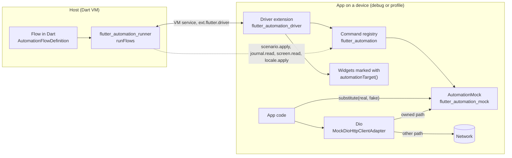

# flutter_automation

Packages that let an agent drive a Flutter app on a device and walk a user
journey from the command line.

## Idea

- The app marks the elements an agent may address with a target enum.
- The app opens a Flutter Driver extension, only in a build that sets
  `ENABLE_AUTOMATION`.
- A flow is Dart code that lists steps (tap, wait, type, read a frame). The
  runner on the host sends the steps to the app and prints one JSON report.
- A mock backend puts the app into a known state without a remote
  environment. The flow names the state; the runner pushes it into the app
  before the first step.
- A release build holds none of it: the switches are compile-time constants.

## How the parts connect



The runner never links to the app. It talks to the driver extension through
the VM service. `scenario.apply` carries the scenario of the flow, and
`journal.read` brings back what the app requested. `screen.read` reads the
screen, the texts and the widgets of a frame. `locale.apply` sets the language.
The last two belong to the driver, so `--locale` works on an app without a
mock.

## Packages

| Package | Purpose |
| --- | --- |
| [`flutter_automation`](packages/flutter_automation) | Target markup, command registry, build switches. |
| [`flutter_automation_driver`](packages/flutter_automation_driver) | Driver extension for the app and the finders the host uses. |
| [`flutter_automation_mock`](packages/flutter_automation_mock) | Scenario, `MockSection`, `AutomationMock`, `MockScenarioBackend`, transport and journal. HTTP-client free. |
| [`flutter_automation_mock_dio`](packages/flutter_automation_mock_dio) | `MockDioHttpClientAdapter` that answers Dio requests from the mock. |
| [`flutter_automation_runner`](packages/flutter_automation_runner) | `runFlows` and the Dart flow definition. |

## Install

All packages come as git dependencies. The tag is the version of the set.

```yaml
dependencies:
  flutter_automation:
    git:
      url: https://github.com/valeriinov/flutter_automation.git
      path: packages/flutter_automation
      ref: 0.5.0
  flutter_automation_driver:
    git:
      url: https://github.com/valeriinov/flutter_automation.git
      path: packages/flutter_automation_driver
      ref: 0.5.0
  flutter_automation_mock:
    git:
      url: https://github.com/valeriinov/flutter_automation.git
      path: packages/flutter_automation_mock
      ref: 0.5.0
  # Only for an app that uses Dio.
  flutter_automation_mock_dio:
    git:
      url: https://github.com/valeriinov/flutter_automation.git
      path: packages/flutter_automation_mock_dio
      ref: 0.5.0

dev_dependencies:
  flutter_automation_runner:
    git:
      url: https://github.com/valeriinov/flutter_automation.git
      path: packages/flutter_automation_runner
      ref: 0.5.0
```

Skip `flutter_automation_mock` and `flutter_automation_mock_dio` when the app
needs no mock. The runner pulls in the other packages it needs.

## Quick start

A complete app lives in [`example/`](example).

1. Declare the targets. One enum per flow, in a file that imports no Flutter
   code, so a flow on the host reads it.

   ```dart
   import 'package:flutter_automation/automation_target.dart';

   enum LoginTarget with AutomationIdComposer {
     screen(AutomationTargetType.screen),
     submit(AutomationTargetType.button);

     @override
     final AutomationTargetType type;

     const LoginTarget(this.type);

     @override
     String get scope => 'login';
   }
   ```

2. Mark the widgets.

   ```dart
   import 'package:flutter_automation/flutter_automation.dart';

   FilledButton(onPressed: onSubmit, child: const Text('Sign in'))
       .automationTarget(LoginTarget.submit)
   ```

3. Install the driver extension as the first statement of `main`.

   ```dart
   import 'package:flutter_automation_driver/driver_extension.dart';

   void main() {
     AutomationInstaller.maybeInstall(screenReader: () => {'screenName': 'login'});
     runApp(const App());
   }
   ```

   The call does nothing unless the app runs with
   `--dart-define=ENABLE_AUTOMATION=true`. A release build never enables it.
   Pass `localeApplier: (languageCode) => ...` to the same call to let
   `--locale` set the language of the app. To launch in that language, start
   the app in `AutomationInstaller.launchLanguageCode` when it is not `null`.

4. Write a flow and an entry point.

   ```dart
   // tool/flows/login_flow.dart
   import 'package:flutter_automation_runner/automation_flow_definition.dart';

   final loginFlow = AutomationFlowDefinition(
     name: 'login',
     variants: [
       FlowVariant('default', items: [
         const WaitFor(ByTarget(LoginTarget.screen)),
         const Tap(ByTarget(LoginTarget.submit)),
       ]),
     ],
   );

   // tool/run_flows.dart
   import 'package:flutter_automation_runner/flutter_automation_runner.dart';

   Future<void> main(List<String> args) => runFlows(args, [loginFlow]);
   ```

5. Run the app, then the flow.

   ```shell
   fvm flutter run -d <device> --dart-define=ENABLE_AUTOMATION=true
   fvm dart run tool/run_flows.dart login default --dry-run
   fvm dart run tool/run_flows.dart login default --uri ws://127.0.0.1:<port>/<token>=/ws
   ```

   `--dry-run` expands the steps on the host and needs no device. `--uri` is the
   VM service address that `flutter run` prints.

## Add the mock

Read [`flutter_automation_mock`](packages/flutter_automation_mock) first. The
path in short:

1. Declare one `MockSection` per backend area, in a file that imports no
   Flutter code. A section names its settings class and its profiles. A
   profile is a function over the settings, so no key is written twice.
2. Call `AutomationMock.init` before the dependency injection of the app, with
   an `isEnabled` that is a compile-time constant of the project.
3. Put the substitutes in place. Use one of two ways:
   - `mock.substitute` at the place where the app creates the object. For Dio
     use `MockDioHttpClientAdapter` over a `MockScenarioBackend`; for storage
     see the [recipes](packages/flutter_automation_mock/doc/recipes.md).
   - One installer that runs after the dependency injection and replaces the
     registered objects.
4. Name the scenario in a flow with `scenario: [section.profile('name')]`. A
   variant continues the list of overrides of its flow.

## Agent skills

The skills tell an agent how to walk flows, drive a device, mock the backend and
mark widgets. The skill version equals the package tag. A project describes its
own facts (commands, folders, defaults) in an `## Automation` section of its
`AGENTS.md`; the template is
[`templates/AGENTS.automation.md`](templates/AGENTS.automation.md). The
`setup-automation` skill writes that section and sets the project up.

| Skill | Purpose | Needs the plugin workflow |
|---|---|---|
| `run-flow` | Walk one variant of a flow on a device: resolve the request to a flow and variant, add the variant and its mock scenario, expand with `--dry-run`, run it, read the report, fix one thing per round | optional (the `measure-flow` workflow scripts the measure-and-fix loop) |
| `drive-device` | Pick and boot a device, launch the app with Flutter Driver, drive it tap by tap, read errors, take screenshots and video | — |
| `mock-app` | Run the app on the in-memory mock, choose scenarios and profiles, tune a `MockSection`, add a mock api | — |
| `add-automation-targets` | Declare target enums and mark widgets with `automationTarget()` so a flow addresses ids, not text | — |
| `setup-automation` | Set a project up from `flutter create`: dependencies at the tag, `flutter_automation:` section, `## Automation` in `AGENTS.md`, driver in `main`, `run_flows.dart` and a first flow, optionally the mock | — |

The workflows `measure-flow` and `optimize-flow` ship in the Claude Code plugin only.

### Claude Code

Skills and workflows in one step:

```
/plugin marketplace add valeriinov/flutter_automation
/plugin install flutter-automation@flutter-automation
```

Skills run as `/flutter-automation:<skill>`. The workflows run as
`/flutter-automation:measure-flow` and `/flutter-automation:optimize-flow`. Nothing
is written to `~/.claude/skills/`, so your own skills keep their names.

Update and remove:

```bash
claude plugin update flutter-automation@flutter-automation
claude plugin uninstall flutter-automation@flutter-automation
```

### Codex and other agents

Via [npx skills](https://github.com/vercel-labs/skills), pinned to a tag:

```bash
npx skills add https://github.com/valeriinov/flutter_automation/tree/<tag>
```

The form with `/tree/<tag>` records `ref` in `skills-lock.json`. The form
`owner/repo@<tag>` does not (checked with skills 1.8.1). This route installs
skills only. The `run-flow` skill works without the `measure-flow` workflow: the loop (expand,
three runs, median, one fix) runs by hand. One agent only:

```bash
npx skills add https://github.com/valeriinov/flutter_automation/tree/<tag> -a codex
```

Single skill: add `--skill run-flow`. `run-flow` needs `drive-device`,
`mock-app` and `add-automation-targets`, so name all four:

```bash
npx skills add https://github.com/valeriinov/flutter_automation/tree/<tag> \
  --skill run-flow --skill drive-device --skill mock-app \
  --skill add-automation-targets
```

 Update: `npx skills update`. Remove:
`npx skills remove run-flow`.

Use the same `<tag>` for the packages in `pubspec.yaml`. The `setup-automation`
skill reads the tag from `skills-lock.json` or the plugin and uses it for every
`ref`.

## Development

```shell
fvm flutter pub get
fvm dart run melos run analyze
fvm dart run melos run test
fvm dart run melos run format
```

The five packages and `example/` are members of one pub workspace. CI runs the
same commands and builds the example (`.github/workflows/ci.yml`).

## License

MIT
